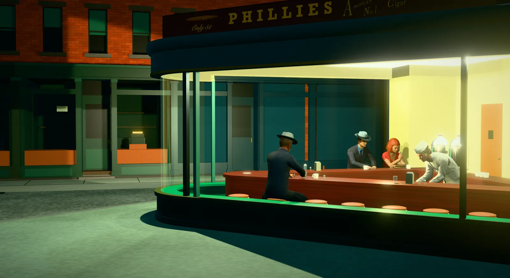

# Nighthawks

[](https://pagustafsson.github.io/nighthawks/)

A free-roaming 3D scene after Edward Hopper's *Nighthawks* (1942), built with [three.js](https://threejs.org). The camera opens on Hopper's own viewpoint, reconstructed from the perspective of the painting, and the lighting follows his: the diner glows from within and throws its light onto the dark street. You can fly around the whole block and look at it from any angle, while the four figures move in a quiet 48-second loop.

**[Try it live](https://pagustafsson.github.io/nighthawks/)**

Created by [@pagustafsson](https://x.com/pagustafsson) with Claude Opus 5.5 by Anthropic.

If you like Nighthawks, here is a way to show your appreciation: [buy me a coffee](https://buymeacoffee.com/pagustafsson) ☕

## Getting started

You need [Node.js](https://nodejs.org) 20 or later.

```bash
npm install
npm run dev
```

Then open the address Vite prints. `npm run build` writes a static site to `dist/`. Every push to `main` is built and published to GitHub Pages by `.github/workflows/pages.yml`.

## Views

| Key | View |
| --- | --- |
| 1 | **Hopper's angle**: the painting's own viewpoint |
| 2 | **The block**: the whole corner from a distance and above |
| 3 | **Lonely stranger**: through the eyes of the man with his back to us, looking at the couple |
| 4 | **The street**: down at street level |
| F | **Painting crop**: masks the screen to the painting's proportions |

## Controls

| Input | Action |
| --- | --- |
| Drag | Look around. The picture follows the pointer or your finger. |
| W A S D or arrows | Fly |
| Q / E | Down / up |
| Shift | Fly faster |
| Scroll | Forward / back |
| Right-drag | Orbit the block |
| Z / X | Narrower / wider lens |
| H | Hide the interface |
| P | Pause the figures |
| G | Show the perspective lines used to reconstruct the painting |

The **Copy link** button at the bottom copies the address of the page.

The scene is also published as a [Claude artifact](https://claude.ai/artifact/KW7pu9eg7dpNcr3DaJN6QG).

## How it works

1. **The camera.** The painting (2000 × 1091 px) was measured and projected back into 3D: the horizon, the vanishing points of the glass front and of the street behind, an eye height of 1.65 m and a focal length of 2200 px. Every measurement of the diner and the block in `src/config.js` comes from that projection, so the hero view lines up with the painting.
2. **The light.** The diner is lit from within by point lights for the ceiling tubes, the light bouncing off the counter and walls, the row of windows and the pool of light on the pavement at the glass corner. A spotlight with a mask throws the window light onto the brick house across the street. A faint blue moonlight and a sky light fill in the night. Invisible lamp shades shape the light the way a film crew would, so the ceiling lamps light the room without burning out the walls.
3. **Shadows.** The scene doesn't move, so all shadows are rendered once when the page loads and then kept. This allows soft, detailed shadows at a low cost per frame.
4. **Glass.** The glass is drawn in two passes: a faint green tint that colours what is behind it, and a reflection of the street with a Fresnel term, so the glass reflects more at grazing angles.
5. **Materials.** Brick, asphalt, concrete, cherry wood and the sign are drawn as textures in code when the page loads. Metal and chrome reflect a captured image of the scene.
6. **The figures.** Four rigged figures from Microsoft Rocketbox are posed bone by bone in code, with no animation files: the couple talks and gestures, the man on the left smokes, the waiter works behind the counter and the stranger sits still. Their clothes, hats, hair and short sleeves are adjusted on the fly, and the hat brims shade the faces.
7. **The picture.** A light bloom, a neutral tone curve, a slightly cooler tone in the shadows, a vignette and a fine film grain finish the image.

## Requirements

- A current version of Chrome, Safari, Edge or Firefox with WebGL2.
- If the frame rate drops, the scene lowers its resolution step by step to keep moving smoothly.

## Project layout

- `src/config.js`: measurements projected back from the painting
- `src/world/`: the block, the diner, the interior, the buildings and the figures
- `src/lighting.js`, `src/post.js`: lights, baked shadows and post-processing
- `src/materials.js`, `src/textures.js`: materials and textures drawn in code
- `src/controls.js`: fly and drag controls
- `public/models/`: the rigged figures
- `tools/rocketbox/`: scripts that convert the figures

## Credits and references

- Edward Hopper, *Nighthawks* (1942, Art Institute of Chicago): the painting this scene is an homage to. This repository contains no reproduction of the painting itself.
- [Microsoft Rocketbox](https://github.com/microsoft/Microsoft-Rocketbox) (MIT license): the four figures. See `public/models/README.md` for what was changed.
- [three.js](https://threejs.org) (MIT license): rendering, loading and post-processing.

## License

MIT, see [LICENSE](LICENSE). Keep the copyright notice when you use or share the code. A mention of [@pagustafsson](https://x.com/pagustafsson) and the name Nighthawks is appreciated. The Rocketbox figures keep their own MIT license from Microsoft (`public/models/LICENSE-Rocketbox.md`).
